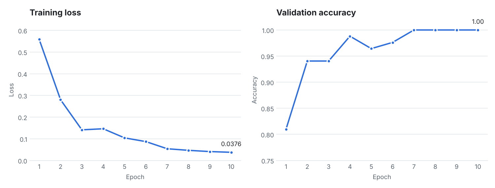
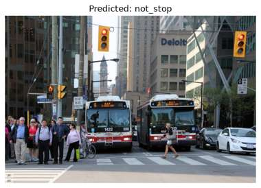

# Stop Sign Classifier (Transfer Learning with PyTorch)

Binary image classifier that detects whether an image contains a **stop sign** (`stop`) or not (`not_stop`).
It uses a **ResNet-18** pretrained on ImageNet as a frozen feature extractor, and only the final fully connected layer is trained on the stop-sign dataset.

Built as the final project of the IBM *Computer Vision* course on Coursera (PyTorch transfer-learning project).

## Results

| Item | Value |
|---|---|
| Backbone | ResNet-18 (ImageNet weights, frozen) |
| Trained layer | `fc` (512 -> 2) |
| Train / validation split | 90% / 10% per class |
| Epochs / batch size | 10 / 12 |
| Optimizer | SGD (momentum 0.9) + CyclicLR (0.001 - 0.01, `triangular2`) |
| Best validation accuracy | **100%** (reached from epoch 7) |

The training loss decreased steadily from ~0.56 to ~0.04, and validation accuracy rose from ~81% to 100%.



Example prediction on an unseen street photo with no stop sign:



Note: the validation set is small (84 images), so treat the 100% figure with caution. More data and a separate test set would give a more reliable estimate.

## Project structure

```
stop-sign-classifier/
├── notebook/
│   └── Final_assignment.ipynb   # full walkthrough with exercises and outputs
├── src/
│   ├── prepare_data.py          # download dataset + 90/10 train/val split
│   ├── train.py                 # train the classifier, saves model.pt
│   └── predict.py               # classify a single image
├── docs/                        # images used in this README
├── requirements.txt
├── .gitignore
└── README.md
```

## Setup

```bash
python -m venv .venv
source .venv/bin/activate        # Windows: .venv\Scripts\activate
pip install -r requirements.txt
```

## Usage

```bash
# 1) Download the data and create dataset/train and dataset/val
python src/prepare_data.py

# 2) Train (saves model.pt in the project root)
python src/train.py --epochs 10 --batch-size 12

# 3) Predict on an image
python src/predict.py path/to/image.jpg
```

## How it works

1. **Preprocessing**: resize to 224x224, convert to tensor, normalize with ImageNet mean/std (`[0.485, 0.456, 0.406]`, `[0.229, 0.224, 0.225]`).
2. **Model**: load ResNet-18 pretrained weights, freeze all parameters, replace `model.fc` with `nn.Linear(512, 2)`.
3. **Training**: cross-entropy loss, SGD with momentum, cyclical learning rate. After every epoch the model is evaluated on the validation set and the best weights are kept.
4. **Inference**: apply the same transforms, add a batch dimension, take the `argmax` of the output.

## Dataset

The dataset (labeled stop / not-stop images with an `_annotations.json` file) is provided by the course and is downloaded by `src/prepare_data.py`. It is not stored in this repository.

